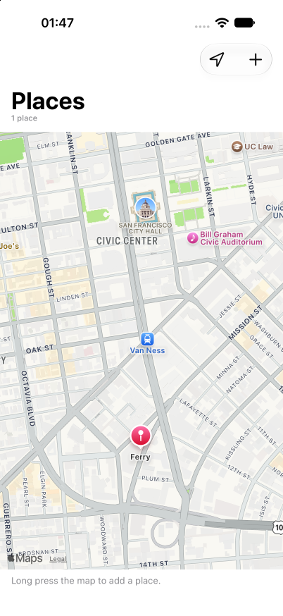
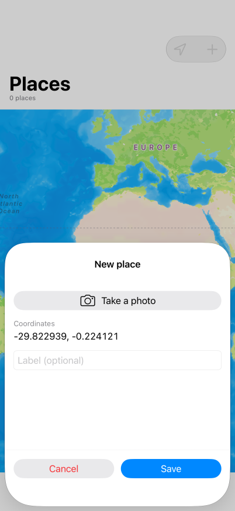

# Places

Una app hecha con **Exact**, el SDK de apps de Expo, para registrar los lugares que visitaste: mapa nativo de iOS, un long tap para marcar y un bottom sheet para la foto, el label y guardar.

| Mapa | Nuevo lugar |
| --- | --- |
|  |  |

## Qué hace

- Mapa nativo (MapKit) con los lugares como pines, el punto azul del GPS y la cámara centrada en tu posición.
- Long tap de 0.45 s sobre el mapa: abre el bottom sheet con la latitud y longitud ya cargadas.
- Foto del lugar con la cámara del sistema, label descriptivo opcional, **Guardar** y **Cancelar** (outlined, rojo).
- Los lugares quedan en `app:/data/places.json` y las fotos en `app:/data/photos/`; al relanzar, el mapa encuadra los pines.
- Botón `+` para agregar en el centro del mapa sin gesto (y para VoiceOver).

Está pensada para iPhone. En web se ve la lista de los lugares guardados: el mapa es nativo.

## Correr

Necesita el SDK de Exact. La primera vez:

```sh
bun exact.mjs --help          # crea .exact/checkout
bun exact.mjs test web
bun exact.mjs test ios
bun exact.mjs verify ios
bun exact.mjs ios --run
```

`EXACT=<checkout>` elige otro checkout de Exact. Las dependencias de `package.json` apuntan al checkout local (`.exact/checkout`), que no se versiona.

## Archivos

- `app.contract`: la vista, el estado y las acciones.
- `app.ts`: los datos (JSON y fotos) y los permisos (`device.camera`, `device.geolocation`).
- `modules/apple/PlaceMap.swift`: el mapa MapKit, los pines y el long press.
- `app.test.contract`: las pruebas.
- `strings/en.json`: los textos de los permisos.
- `assets/icon.png`: el ícono.
